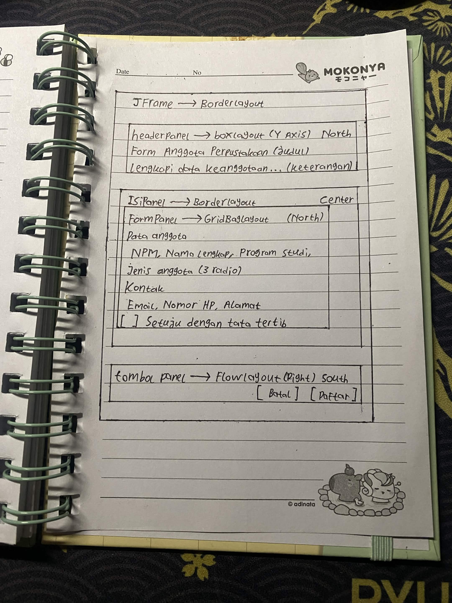
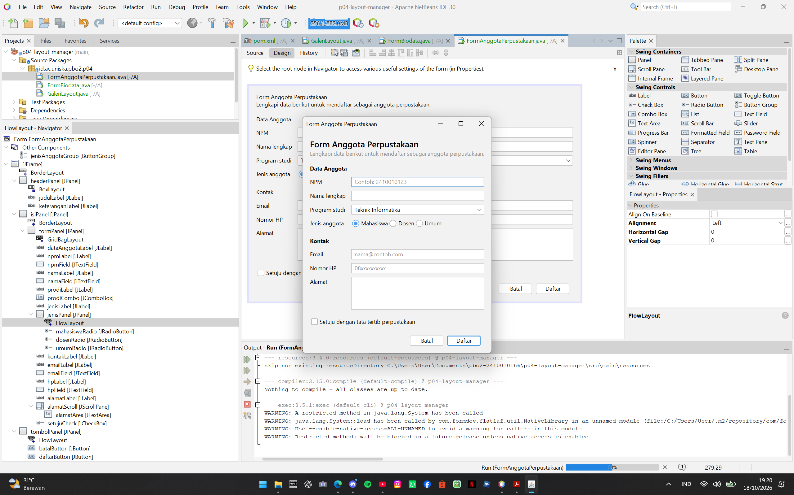
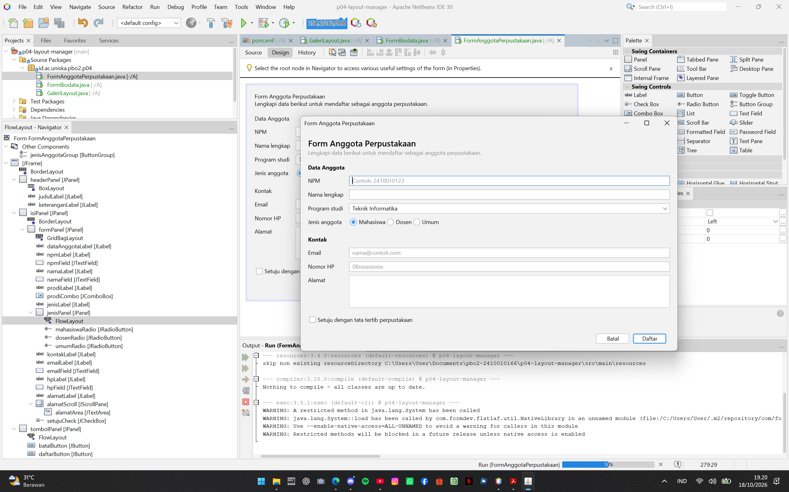
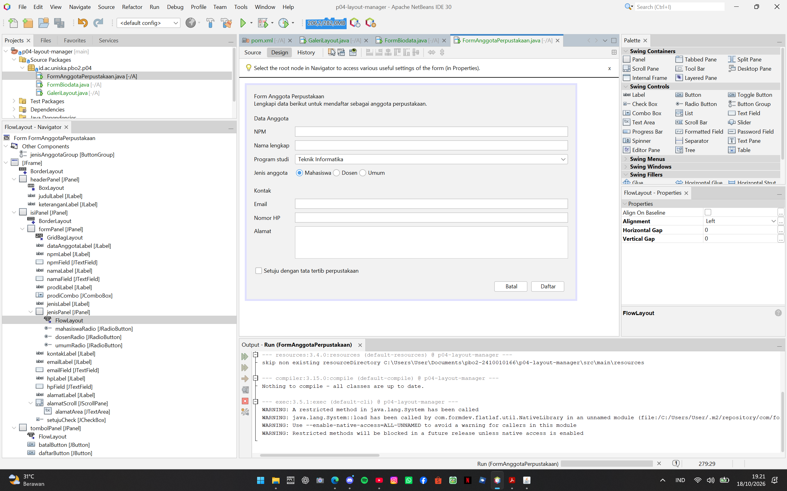

# P04 - Layout Manager dan Desain Form

| | |
|---|---|
| Nama | M. Ridho Fadillah |
| NIM | 2410010166 |
| Kelas | 5B Reguler Banjarmasin |
| Mata Kuliah | Pemrograman Berbasis Objek 2 (TIF1508) |

Proyek ini berisi tiga form dengan JFrame Form dan layout manager: `GaleriLayout`, `FormBiodata`, dan `FormAnggotaPerpustakaan` (masing-masing dengan file `.java` dan `.form`).

---

## 1. Sketsa Form Anggota Perpustakaan

## 2. Tabel Rancangan

| Bagian | Panel | Layout |
|---|---|---|
| Jendela | JFrame | BorderLayout |
| Header | `headerPanel` | BoxLayout (Y Axis) |
| Isi form | `isiPanel` membungkus `formPanel` | `isiPanel`: BorderLayout; `formPanel`: GridBagLayout |
| Tombol | `tombolPanel` | FlowLayout (Alignment Right) |

## 3. Tangkapan Layar FormAnggotaPerpustakaan

**Ukuran awal**

**Saat dilebarkan**

**Tab Design dan jendela Navigator**

---

## 4. Eksperimen Praktikum 2 (GaleriLayout)

**Eksperimen 1: `flowPanel`, Alignment Center**

Ketika tab di-resize, dengan Alignment Left tombol-tombol selalu berada di sisi kiri, sedangkan dengan Center tombol-tombol selalu berada di tengah dan menyesuaikan dengan ukuran tab. Baris yang berubah di `initComponents()` hanya baris 191, dari `flowPanel.setLayout(new java.awt.FlowLayout(java.awt.FlowLayout.LEFT, 8, 8));` menjadi `flowPanel.setLayout(new java.awt.FlowLayout(java.awt.FlowLayout.CENTER, 8, 8));`.

**Eksperimen 2: `gridPanel`, Rows 0 dan Columns 2**

Setelah Rows diubah menjadi 0 dan Columns menjadi 2, susunan tombol yang tadinya 3x3 menjadi 5 baris x 2 kolom, dengan baris terakhir hanya berisi tombol 9. Hal ini terjadi karena ketika Rows bernilai 0, jumlah baris dihitung otomatis dari jumlah komponen dibagi jumlah kolom (9 ÷ 2 = 4,5, dibulatkan ke atas menjadi 5). Baris yang berubah adalah baris 103, dari `new java.awt.GridLayout(3, 3, 8, 8)` menjadi `new java.awt.GridLayout(0, 2, 8, 8)`.

**Eksperimen 3: `boxPanel`, maximumSize dan Vertical Strut**

Setelah maximumSize diisi (lebar 32767 dan tinggi sama dengan tinggi tombol), tombol melebar sampai ke ujung tab dengan tinggi yang sama. Setelah Vertical Strut ditambahkan selang-seling di antara tombol, muncul jarak vertikal pada tiap tombol.

## 5. Eksperimen Praktikum 4 (FormBiodata)

**Eksperimen 1: Weight X `namaField` menjadi 0.0**

Setelah Weight X pada `namaField` diubah menjadi 0.0, `namaField` tetap ikut melebar saat jendela dilebarkan. Hal ini terjadi karena Weight X dihitung per kolom dengan nilai terbesar di kolom itu yang dipakai. Kolom isian masih berisi komponen lain (`npmField`, `prodiCombo`, dan seterusnya) yang ber-Weight X 1.0, dan `namaField` memakai Fill Horizontal sehingga mengisi lebar kolomnya.

**Eksperimen 2: Direction `formPanel` dari North menjadi Center**

Ketika Direction `formPanel` diubah ke Center lalu jendela disempitkan, komponen di bagian atas dan bawah form sama-sama tidak terlihat. Sedangkan dengan North, hanya bagian bawah form yang tidak terlihat saat jendela disempitkan. Baris kode yang berubah di `initComponents()` adalah `isiPanel.add(formPanel, java.awt.BorderLayout.NORTH);` menjadi `isiPanel.add(formPanel, java.awt.BorderLayout.CENTER);`.

**Eksperimen 3: menghapus `setMinimumSize(getSize())`**

Dengan kode `setMinimumSize(getSize())`, jendela tidak bisa dikecilkan sekecil-kecilnya. Tanpa kode tersebut, jendela bisa dikecilkan sekecil-kecilnya.

---

## 6. Saling Menilai (Tahap 4)

Dinilai oleh: **[ISI NAMA TEMAN]**

| No | Pemeriksaan | Ya / Belum |
|----|-------------|------------|
| 1 | Label singkat, jelas, dan sejajar | Ya |
| 2 | Isian dikelompokkan dengan judul bagian | Ya |
| 3 | Placeholder dipakai untuk isian yang punya format | Ya |
| 4 | Komponen sesuai jenis data | Ya |
| 5 | Tombol utama menonjol dan berada di kanan bawah | Ya |
| 6 | Jarak antar komponen konsisten | Ya |
| 7 | Form tetap rapi saat jendela dilebarkan dan ditinggikan | Ya |
| 8 | Tampilan dibuat dengan JFrame Form dan layout manager, bukan Null Layout atau Absolute Layout | Ya |

Saran dari teman:

> "Tambahkan satu prodi lagi pada pilihan prodi yaitu Manajemen Informatika."

Tindak lanjut: saran sudah diterapkan. Combo Box Program studi kini berisi Teknik Informatika, Sistem Informasi, dan Manajemen Informatika. Tangkapan layar di atas diambil sebelum saran diterapkan.

## 7. Jawaban Refleksi

1. **Mengapa Null Layout dan Absolute Layout sebaiknya dihindari?**
   Keduanya memakai posisi piksel yang tetap, sehingga tampilan tidak menyesuaikan ukuran jendela dan teks dapat terpotong pada skala layar berbeda. Absolute Layout juga membutuhkan library tambahan NetBeans sehingga aplikasi sulit dijalankan di komputer lain.

2. **Perbedaan perilaku FlowLayout dan GridLayout saat jendela dilebarkan.**
   FlowLayout mempertahankan ukuran asli komponen, menderetkannya, dan pindah baris jika tidak muat. GridLayout membagi ruang menjadi sel-sel sama besar, sehingga semua komponen ikut melebar dan meninggi sama rata.

3. **Fungsi Weight X dan Fill pada constraint GridBagLayout.**
   Weight X menentukan pembagian sisa lebar antar kolom (0.0 untuk label, 1.0 untuk isian). Fill menentukan apakah komponen memenuhi selnya; Fill Horizontal membuat isian melebar mengisi sel. Keduanya dipakai bersama agar isian ikut melebar sementara label tetap.

4. **Mengapa `formPanel` dibungkus `isiPanel` dan diletakkan di North?**
   Wilayah North pada BorderLayout mempertahankan tinggi asli `formPanel`, sehingga baris form tetap menempel di atas saat jendela ditinggikan. Pada eksperimen, ketika Direction diubah ke Center, `formPanel` direntangkan memenuhi tinggi `isiPanel` dan barisnya bergeser ke tengah.

5. **Dua prinsip desain pada Form Anggota Perpustakaan dan buktinya.**
   - **Keselarasan:** semua label berada di kolom kiri dan semua isian di kolom kanan sehingga membentuk garis lurus (lihat `img/anggota-awal.png`).
   - **Kedekatan:** isian yang berkaitan dikelompokkan dengan judul bagian "Data Anggota" dan "Kontak" (lihat `img/anggota-awal.png`).

## 8. Deklarasi Penggunaan AI

Alat yang digunakan: Claude (Anthropic).

Digunakan untuk: memandu urutan pengerjaan modul, menjelaskan konsep layout manager dan constraint GridBagLayout, membantu menemukan penyebab kesalahan pada form (misalnya Grid X/Grid Y yang belum benar dan blok Nimbus yang belum terhapus), serta membantu merapikan kalimat jawaban dan menyusun kerangka README.

Perancangan sketsa, pembuatan form di NetBeans, pelaksanaan eksperimen, dan pengamatan hasilnya saya kerjakan sendiri.
