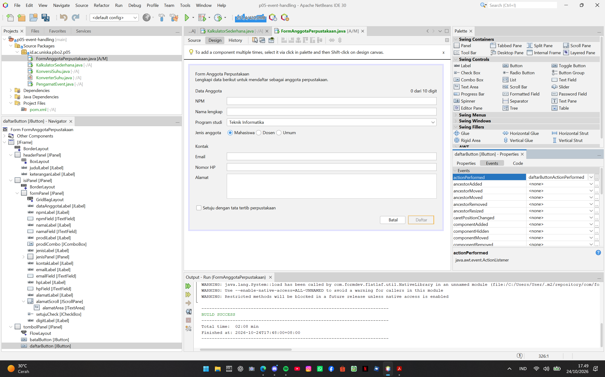
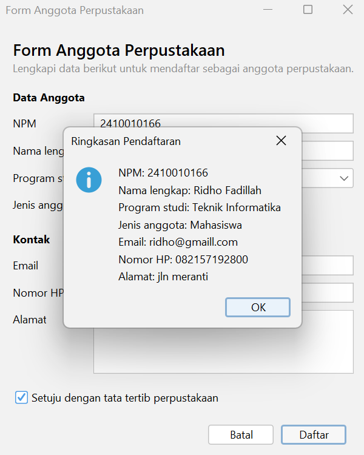
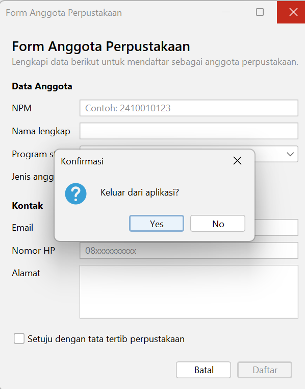

# P05 - Event Handling

| | |
|---|---|
| Nama | M. Ridho Fadillah |
| NIM | 2410010166 |
| Kelas | 5B Reguler Banjarmasin |
| Mata Kuliah | Pemrograman Berbasis Objek 2 |

Proyek `p05-event-handling` berisi: `PengamatEvent`, `KonversiSuhu` (dengan kelas logika `KonverterSuhu`), `KalkulatorSederhana`, dan `FormAnggotaPerpustakaan` yang sudah memiliki event. Semua form dibuat dengan JFrame Form (file `.java` dan `.form`), dan event dibuat lewat menu Events di GUI Builder.

---

## 1. Peta Event FormAnggotaPerpustakaan

| Komponen | Menu Events | Event | Method | Aksi |
|---|---|---|---|---|
| `setujuCheck` | Item | itemStateChanged | `setujuCheckItemStateChanged` | Tombol Daftar hanya aktif jika kotak dicentang |
| `batalButton` | Action | actionPerformed | `batalButtonActionPerformed` | Mengosongkan semua isian dan mengembalikan fokus ke NPM |
| `daftarButton` | Action | actionPerformed | `daftarButtonActionPerformed` | Menampilkan ringkasan data dengan JOptionPane |
| `npmField` | Key | keyReleased | `npmFieldKeyReleased` | Label kecil menampilkan jumlah digit, misalnya "7 dari 10 digit" |
| Form (`[JFrame]`) | Window | windowClosing | `formWindowClosing` | Meminta konfirmasi sebelum aplikasi ditutup |

Pengaturan Properties tambahan: `defaultCloseOperation` form diubah menjadi `DO_NOTHING`, dan properti `enabled` tombol Daftar tidak dicentang.

## 2. Tangkapan Layar

**Properties bagian Events untuk tombol Daftar**

**Dialog ringkasan**

**Dialog konfirmasi keluar**

---

## 3. Tabel Pengamatan Praktikum 2 (PengamatEvent)

| No | Tindakan | Event yang tercatat |
|----|----------|---------------------|
| 1 | Arahkan kursor ke tombol, lalu jauhkan | MouseEvent "kursor masuk ke tombol", lalu MouseEvent "kursor keluar dari tombol" |
| 2 | Klik tombol Klik saya | MouseEvent "kursor masuk ke tombol", lalu ActionEvent "tombol diklik". Saat kursor dijauhkan, muncul MouseEvent "kursor keluar dari tombol" |
| 3 | Centang lalu hapus centang Aktifkan fitur | ItemEvent "kotak dicentang", lalu ItemEvent "centang dihapus" |
| 4 | Ganti pilihan dari Pagi menjadi Malam | ItemEvent "memilih Malam" (hanya satu baris karena sudah dicek SELECTED) |
| 5 | Klik isian, lalu ketik kata "abc" | FocusEvent "isian mendapat fokus", lalu tiga KeyEvent: huruf a, b, dan c |
| 6 | Klik tombol setelah mengetik di isian | MouseEvent "kursor masuk ke tombol", FocusEvent "isian kehilangan fokus", lalu ActionEvent "tombol diklik" |

## 4. Eksperimen Praktikum 3 (KonversiSuhu)

**Eksperimen 1: menghapus pemeriksaan SELECTED**

Pesan "item berubah" tercetak 2 kali setiap pilihan combo diganti. Itu karena event dipanggil sekali untuk pilihan lama (DESELECTED) dan sekali untuk pilihan baru (SELECTED). Kalau pakai pemeriksaan `if (evt.getStateChange() == ItemEvent.SELECTED)`, aksinya cuma jalan sekali.

**Eksperimen 2: keyPressed menggantikan keyReleased**

Hasil yang tampil terlambat satu karakter. Misalnya baru mengetik angka 3, hasilnya masih kosong, dan baru berubah setelah mengetik karakter berikutnya. Itu karena `keyPressed` terjadi saat tombol ditekan, sebelum karakternya masuk ke isian, jadi `getText()` masih membaca isi yang lama. `keyReleased` terjadi saat tombol dilepas, ketika karakternya sudah masuk ke isian.

**Eksperimen 3: menghapus try dan catch**

Saat mengetik huruf di isian, di jendela Output muncul error `NumberFormatException` dengan keterangan `For input string` dan huruf yang diketik. Label hasil tidak berubah dan tidak menampilkan "Masukkan angka yang valid". Itu karena `Double.parseDouble` tidak bisa mengubah huruf jadi angka, dan tanpa `catch` errornya tidak ditangani.

## 5. Eksperimen Praktikum 4 (KalkulatorSederhana)

**Eksperimen 1: dua cara di satu tombol**

Pesan "kali" tercetak 2 kali setiap tombol x diklik. Itu karena tombol x punya dua cara sekaligus: event handler dari GUI Builder dan lambda di konstruktor, dan keduanya jalan. Makanya satu tombol sebaiknya cuma pakai satu cara, supaya aksinya tidak jalan dua kali.

**Eksperimen 2: menambah tombol %**

Di tab Design, ditambah tombol `%` (`modButton`) di `operatorPanel`, lalu Columns di GridLayout diubah dari 4 jadi 5, dan dibuat event actionPerformed yang isinya `hitung('%');`. Di tab Source, pada method `hitung` ditambah `case '%' -> a % b;` di dalam switch, dan pengecekan bagi nol diubah supaya `%` juga ikut dicek.

**Eksperimen 3: tombol Hapus**

Kursor langsung ada di isian pertama karena method `hapus` memanggil `angka1Field.requestFocusInWindow();`. Baris itu mengembalikan fokus ke isian pertama, jadi kita bisa langsung mengetik angka baru tanpa klik isian lagi.

---

## 6. Jawaban Refleksi

1. **Peran sumber event, object event, dan listener.**
   Sumber event adalah komponen tempat kejadian terjadi, misalnya `daftarButton` yang diklik. Object event berisi informasi tentang kejadian itu, misalnya `ActionEvent evt` pada `daftarButtonActionPerformed(java.awt.event.ActionEvent evt)`. Listener adalah object yang menjalankan tanggapan dan didaftarkan lewat `addActionListener()`, yaitu `ActionListener` yang dibuat NetBeans di `initComponents()` dan memanggil method `daftarButtonActionPerformed`.

2. **Mengapa KeyListener tidak dapat ditulis dengan lambda, dan bagaimana NetBeans mengatasinya.**
   Lambda hanya bisa dipakai untuk interface yang punya satu method abstract. `KeyListener` punya tiga method (`keyPressed`, `keyReleased`, `keyTyped`), jadi tidak bisa pakai lambda dan semua method wajib ditulis. Saat memilih event `keyReleased`, NetBeans otomatis memakai `KeyAdapter`, yaitu kelas adapter yang sudah berisi implementasi kosong semua method, sehingga hanya `keyReleased` yang perlu diisi.

3. **Keuntungan memisahkan KonverterSuhu dari form KonversiSuhu.**
   Logika konversi jadi terpisah dari tampilan, sehingga bisa dipakai ulang di form lain dan mudah diuji tanpa membuka GUI. Kalau tampilan diubah, rumus konversi tidak ikut terganggu, dan sebaliknya.

4. **Mengapa itemStateChanged perlu memeriksa ItemEvent.SELECTED.**
   Pada Combo Box, `itemStateChanged` dipanggil dua kali setiap pilihan diganti: sekali untuk pilihan lama (DESELECTED) dan sekali untuk pilihan baru (SELECTED). Tanpa pemeriksaan `SELECTED`, aksinya berjalan dua kali.

5. **Kapan memakai event handler GUI Builder, lambda, atau method reference.**
   Event handler GUI Builder dipakai sebagai cara utama pada JFrame Form, karena tersimpan di file `.form` dan terlihat di menu Events (contoh: tombol `+`, `-`, dan `/` di kalkulator). Lambda dipakai untuk aksi singkat yang ditulis di konstruktor (contoh: `kaliButton.addActionListener(e -> hitung('x'));`). Method reference dipakai kalau aksinya sudah ditulis sebagai method tersendiri (contoh: `hapusButton.addActionListener(this::hapus);`). Satu tombol cukup memakai satu cara.

## 7. Deklarasi Penggunaan AI

Alat yang digunakan: Claude (Anthropic).

Digunakan untuk: memandu urutan pengerjaan modul, menjelaskan konsep event handling (listener, adapter, lambda, dan method reference), membantu menemukan penyebab error (misalnya baris `package` yang belum diubah setelah form disalin dari P04 dan cara menjalankan file yang benar), serta membantu merapikan kalimat jawaban dan menyusun kerangka README.

Pembuatan form di NetBeans, penulisan dan pengujian kode, pelaksanaan eksperimen, dan pengamatan hasilnya saya kerjakan sendiri.
