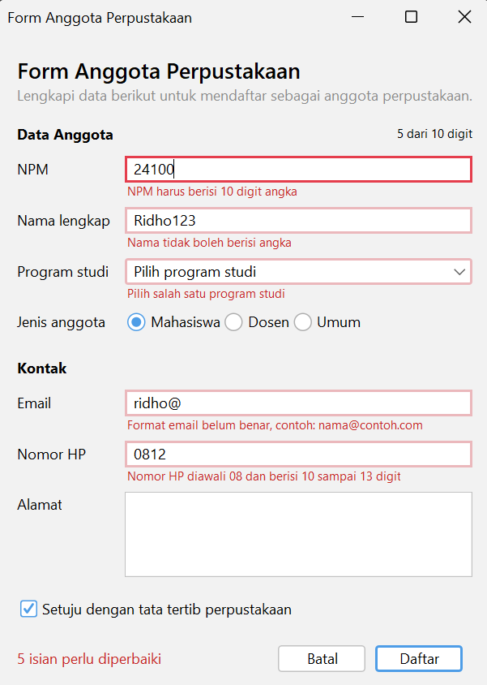
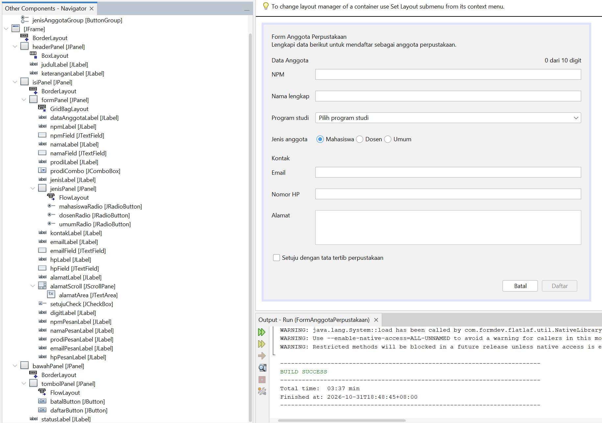
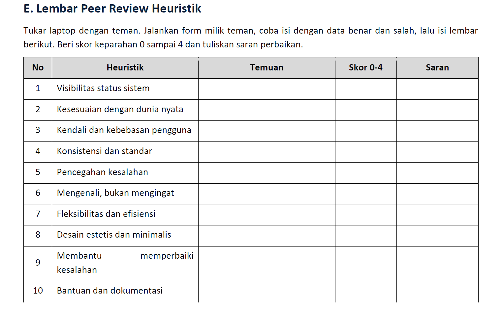

# P06 - Validasi Input dan Kegunaan

Mata kuliah Pemrograman Berbasis Objek 2 (TIF1508), Pertemuan 6.
Proyek Maven: `p06-validasi-input` (package `id.ac.uniska.pbo2.p06`).

## Isi Proyek

| File | Keterangan |
|---|---|
| `Validator.java` | Aturan validasi tanpa GUI (wajib diisi, NPM, nama, email, nomor HP) |
| `UjiValidator.java` | Pengujian aturan `Validator` lewat `main` (13 kasus uji) |
| `FormAnggotaPerpustakaan.java` + `.form` | Form tugas: form anggota yang sudah divalidasi |
| `FormAnggota.java` + `.form` | Form contoh dari modul (Praktikum 3 dan 4) |

### Ringkasan Latihan Mandiri pada `FormAnggotaPerpustakaan`

| No | Ketentuan | Wujud di program |
|---|---|---|
| 1 | Aturan dikumpulkan di `Validator` | `Validator.npm`, `nama`, `email`, `nomorHp`; form hanya memanggilnya lewat `periksaNpm()`, `periksaNama()`, dst. |
| 2 | Nama tidak boleh berisi angka | Aturan baru `nama.matches(".*\\d.*")` di `Validator.nama`, diuji di `UjiValidator` (kasus "Siti123" dan "Budi2 Santoso") |
| 3 | Garis merah + pesan di label bawah isian | `tandai()` memberi `JComponent.outline = "error"` dan mengisi `npmPesanLabel`, `namaPesanLabel`, `prodiPesanLabel`, `emailPesanLabel`, `hpPesanLabel` |
| 4 | NPM dan HP hanya angka (keyTyped) | `npmFieldKeyTyped` dan `hpFieldKeyTyped` memanggil `evt.consume()` untuk karakter bukan angka atau jika sudah penuh (NPM 10, HP 13) |
| 5 | Ringkasan jumlah kesalahan + fokus ke kesalahan pertama | `daftar()` mengisi `statusLabel` ("N isian perlu diperbaiki") dan `salah.get(0).requestFocusInWindow()` |
| 6 | Konfirmasi sebelum mengosongkan form | `batal()` menampilkan `JOptionPane.showConfirmDialog` bila `adaIsian()` |
| 7 | `labelFor`, `displayedMnemonic`, `mnemonic`, `toolTipText` | Semua label punya `labelFor` dan `displayedMnemonic`; radio, kotak centang, dan tombol Batal punya `mnemonic`; `npmField` punya tooltip "Hanya angka, tepat 10 digit" |

Tambahan di luar ketentuan: `digitLabel` yang menghitung digit NPM ("x dari 10 digit") lewat `npmFieldKeyReleased`, dan konfirmasi saat jendela ditutup (`formWindowClosing`).

### Keluaran `UjiValidator`

```
SESUAI NPM kosong: NPM wajib diisi
SESUAI NPM 5 digit: NPM harus berisi 10 digit angka
SESUAI NPM berisi huruf: NPM harus berisi 10 digit angka
SESUAI NPM benar: valid
SESUAI Nama terlalu pendek: Nama minimal 3 huruf
SESUAI Nama benar: valid
SESUAI Nama berisi angka: Nama tidak boleh berisi angka
SESUAI Nama dengan angka di tengah: Nama tidak boleh berisi angka
SESUAI Email tanpa domain: Format email belum benar, contoh: nama@contoh.com
SESUAI Email benar: valid
SESUAI Nomor HP terlalu pendek: Nomor HP diawali 08 dan berisi 10 sampai 13 digit
SESUAI Nomor HP diawali 62: Nomor HP diawali 08 dan berisi 10 sampai 13 digit
SESUAI Nomor HP 12 digit: valid

Semua aturan bekerja sesuai harapan
```

## Tangkapan Layar

**Form dengan pesan kesalahan** (setelah Daftar diklik dengan data salah):



**Jendela Navigator yang memperlihatkan label pesan** (`npmPesanLabel`, `namaPesanLabel`, `prodiPesanLabel`, `emailPesanLabel`, `hpPesanLabel`):



## Peer Review

**Lembar peer review yang saya terima dari teman:**



Nama peninjau: Daffa Masyu Abas (2410010481)

Nama pemilik form: M. Ridho Fadillah (2410010166)

**Tabel temuan dan perbaikan** (berdasarkan lembar peer review yang saya terima):

| No | Heuristik | Temuan dari teman | Skor | Perbaikan yang saya lakukan | Commit |
|---|---|---|---|---|---|
| 1 | Visibilitas status sistem | Tidak ada masalah ditemukan | 0 | Tidak diperlukan | - |
| 2 | Kesesuaian dengan dunia nyata | Tidak ada masalah ditemukan | 0 | Tidak diperlukan | - |
| 3 | Kendali dan kebebasan pengguna | Tidak ada masalah ditemukan | 0 | Tidak diperlukan | - |
| 4 | Konsistensi dan standar | Tidak ada masalah ditemukan | 0 | Tidak diperlukan | - |
| 5 | Pencegahan kesalahan | Tidak ada masalah ditemukan | 0 | Tidak diperlukan | - |
| 6 | Mengenali, bukan mengingat | Tidak ada masalah ditemukan | 0 | Tidak diperlukan | - |
| 7 | Fleksibilitas dan efisiensi | Tidak ada masalah ditemukan | 0 | Tidak diperlukan | - |
| 8 | Desain estetis dan minimalis | Tidak ada masalah ditemukan | 0 | Tidak diperlukan | - |
| 9 | Membantu memperbaiki kesalahan | Tidak ada masalah ditemukan | 0 | Tidak diperlukan | - |
| 10 | Bantuan dan dokumentasi | Tidak ada masalah ditemukan | 0 | Tidak diperlukan | - |

Seluruh 10 heuristik dinilai skor 0 (bukan masalah) oleh peninjau, sehingga tidak ada temuan skor 3 atau 4 yang perlu diperbaiki dan tidak ada commit perbaikan yang terkait lembar ini.

## Jawaban Eksperimen Praktikum 4

Seluruh jawaban di bawah mengacu ke kode `FormAnggotaPerpustakaan.java`.

**1. Ketik huruf pada isian NPM. Apa yang terjadi dan baris mana di `npmFieldKeyTyped` yang menyebabkannya?**
Huruf yang diketik tidak muncul di isian, seolah tombolnya tidak bekerja. Penyebabnya baris 562-563: kondisi `!Character.isDigit(evt.getKeyChar()) || penuh` bernilai `true` untuk huruf, sehingga `evt.consume()` dijalankan. Method `consume()` membatalkan event `keyTyped`, jadi karakter tidak pernah dimasukkan ke isian. Hal yang sama terjadi bila NPM sudah 10 digit (`penuh` bernilai `true`).

**2. Isi email dengan `siti@`, lalu tekan Tab. Kapan pesan kesalahan muncul?**
Pesan muncul tepat saat Tab ditekan, yaitu ketika `emailField` kehilangan fokus. Event `focusLost` memanggil `emailFieldFocusLost`. Karena isian tidak kosong, `periksaEmail()` dijalankan dan memanggil `Validator.email()`, yang mengembalikan "Format email belum benar, contoh: nama@contoh.com". Isian diberi garis merah dan pesan tampil di `emailPesanLabel`. Pesan tidak muncul saat mengetik, hanya saat pindah isian.

**3. Klik isian Nama tanpa mengetik, lalu tekan Tab. Mengapa tidak ada pesan kesalahan?**
Karena `namaFieldFocusLost` hanya memeriksa jika isian tidak kosong (`if (!namaField.getText().isBlank())`). Isian kosong sengaja tidak diperiksa saat fokus hilang. Pengguna yang hanya melewati isian belum tentu salah, dan menandainya merah terlalu cepat terasa seperti dimarahi. Isian kosong baru diperiksa saat tombol Daftar diklik, lewat `Validator.wajibDiisi()`.

**4. Centang persetujuan, lalu klik Daftar dengan form kosong. Isian mana yang mendapat fokus?**
Fokus pindah ke isian NPM. Tombol Daftar baru aktif setelah kotak centang dicentang (`setujuCheckItemStateChanged`). Saat diklik, `daftar()` memeriksa semua isian: NPM, Nama, Program studi, Email, dan Nomor HP ternyata semuanya salah. Kelima isian diberi garis merah dan pesan, `statusLabel` menampilkan "5 isian perlu diperbaiki", dan `salah.get(0).requestFocusInWindow()` memindahkan fokus ke kesalahan pertama pada daftar, yaitu `npmField`.

**5. Tekan Alt bersama huruf N. Isian mana yang mendapat fokus, dan properti apa yang mengaturnya?**
Isian Nama lengkap (`namaField`) yang mendapat fokus. Pengaturnya adalah properti `displayedMnemonic` bernilai `N` pada `namaLabel` yang bekerja bersama properti `labelFor` yang mengarah ke `namaField`. Di kode hasil NetBeans: `namaLabel.setDisplayedMnemonic('N');` dan `namaLabel.setLabelFor(namaField);`. Karena `labelFor`, Alt+N memindahkan fokus ke isian, bukan ke label.

**6. Isi beberapa isian, lalu klik Batal dan pilih No. Apakah data tetap ada?**
Ya, data tetap ada. `batal()` menemukan bahwa `adaIsian()` bernilai `true`, lalu menampilkan dialog "Data yang sudah diisi akan dihapus. Lanjutkan?". Jika dijawab No, `jawab != JOptionPane.YES_OPTION` sehingga method `return` sebelum `kosongkan()` dipanggil. Isian baru dikosongkan bila pengguna memilih Yes.

## Jawaban Pertanyaan Refleksi

**1. Mengapa aturan validasi dipisahkan ke kelas `Validator`, bukan ditulis langsung di event handler?**
Pertama, aturan yang sama dipakai di beberapa tempat (`focusLost` dan `daftar()`), jadi satu aturan cukup ditulis dan diubah di satu tempat. Kedua, `Validator` tidak bergantung pada GUI sehingga bisa diuji tanpa membuka form, seperti yang dilakukan `UjiValidator`. Ketiga, event handler tetap pendek dan hanya mengurus tampilan (garis merah, label, fokus), sedangkan keputusan benar atau salah ada di `Validator`.

**2. Mengapa isian kosong tidak langsung ditandai merah saat pengguna hanya melewatinya?**
Pengguna yang menekan Tab belum tentu lupa mengisi, bisa jadi ia ingin mengisi isian lain dulu. Menandai merah terlalu dini membuat form terasa penuh kesalahan sebelum pengguna sempat bekerja. Karena itu `focusLost` hanya memeriksa isian yang sudah berisi, dan isian kosong diperiksa saat Daftar diklik.

**3. Sebutkan tiga heuristik Nielsen yang diterapkan pada form Anda beserta buktinya.**
- **Pencegahan kesalahan**: `npmFieldKeyTyped` dan `hpFieldKeyTyped` menolak huruf dengan `evt.consume()`; tombol Daftar nonaktif sampai persetujuan dicentang.
- **Membantu memperbaiki kesalahan**: pesan menyebut isian dan caranya, misalnya "Format email belum benar, contoh: nama@contoh.com", lengkap dengan garis merah dan label tepat di bawah isian.
- **Visibilitas status sistem**: `statusLabel` menampilkan "N isian perlu diperbaiki" dan `digitLabel` menampilkan "x dari 10 digit" saat NPM diketik.

Heuristik lain yang juga terlihat: kendali dan kebebasan pengguna (konfirmasi pada tombol Batal dan saat jendela ditutup).

**4. Mengapa pesan kesalahan tidak boleh hanya berupa warna merah?**
Sebagian pengguna buta warna sehingga tidak bisa membedakan merah dari warna lain, dan pembaca layar tidak menyampaikan warna. Dengan teks pesan, semua pengguna tahu isian mana yang salah dan cara memperbaikinya. Warna merah hanya menjadi penguat.

**5. Temuan peer review mana yang paling bermanfaat bagi Anda dan mengapa?**
Dari lembar peer review yang saya terima, Daffa Masyu Abas tidak menemukan masalah pada kesepuluh heuristik (semua skor 0), sehingga tidak ada temuan yang perlu diperbaiki. Hal yang paling bermanfaat bagi saya adalah melihat form saya diuji langsung oleh orang lain dengan data benar dan salah, yang memberi keyakinan bahwa pencegahan input, pesan kesalahan, dan konfirmasi sudah berjalan sesuai tujuan.

## Deklarasi Penggunaan AI

`SESUAIKAN BILA PERLU` Saya menggunakan Claude (Anthropic) untuk membantu menyusun jawaban eksperimen, jawaban refleksi, dan kerangka README ini berdasarkan kode proyek saya. Kode program ditulis dan dijalankan sendiri, dan hasil eksperimen saya periksa ulang dengan menjalankan form.
